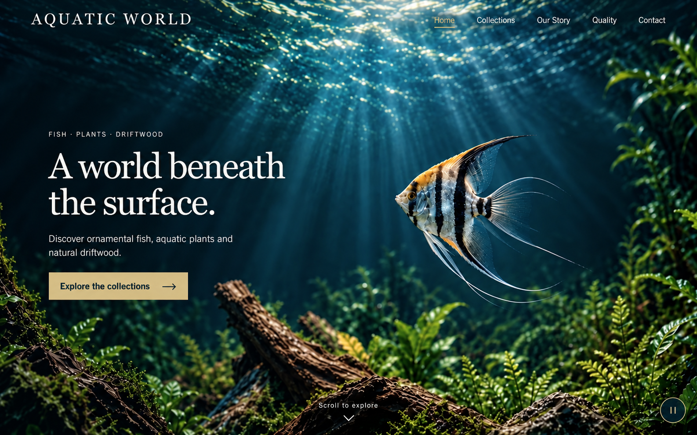
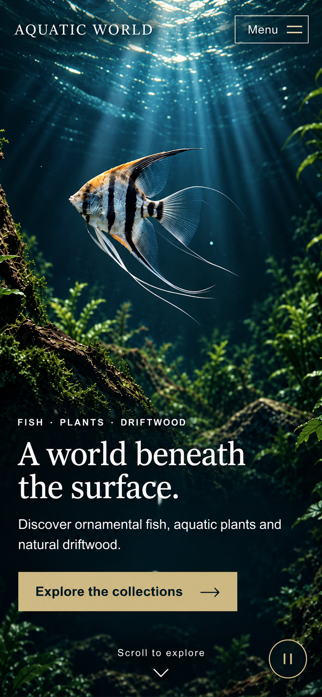
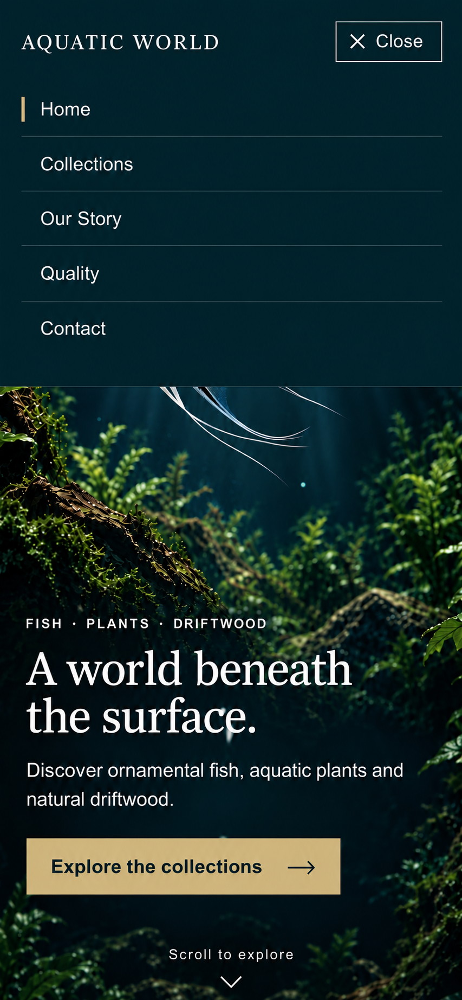

# Fusion Home — Selected Static Visual Concepts v1

Created 2026-10-12 with the built-in `image_gen.imagegen` tool. **Three selected raster concepts for creative review; no website implementation or deployment.** These illustrate one common design direction for a later independent Codex/Claude round.

## Selected files

| Concept | Native dimensions | Bytes | SHA-256 |
| --- | --- | --- | --- |
| [Desktop arrival](desktop-v1.png) | 1586×992 | 2,238,666 | `5a4249c6f5663cffc81ec374df3d98e8dfbefd0d986b9b1ab4e0e08bfac22560` |
| [Phone arrival, closed Menu](mobile-v1.png) | 853×1844 | 2,055,279 | `35208d2061125cc02dd162a147c8046be0f8e0ebe774746299404e115c9c5e65` |
| [Phone navigation, open Menu](mobile-menu-v1.png) | 853×1844 | 1,698,105 | `520779f86a34aa531f79cc6f8e517ee807b71be81cacfcd91e9435b7094b5237` |

The intended reference viewports are 1440×900 and 390×844. Native generated bitmap dimensions are recorded above; they are not browser test dimensions. Selected PNGs are copied byte-for-byte, with no cropping, resizing, compositing or re-encoding outside the image tool.

## Visual review

Desktop retains the stronger cream serif wordmark and regular-weight navigation over visible water. A compact two-line heading and one gold action align with the supporting copy on the left; the complete fish and its long fins occupy the right. There is no boxed film, player toolbar, solid closed header band or central Play button.

Phone retains a separate portrait habitat, with the complete subject above the offer. Its outlined Menu control is easier to discover than the previous unoutlined control. Heading, description and full CTA occupy the lower water, with a small separate pause utility. The selected open state uses a solid top-anchored navigation surface, Close at the same upper-right anchor, five real-destination labels and a gold Home marker. The full offer and CTA remain visible below it; no underlying text ghosts through the panel. The motion utility is absent in this state.

All exact arrival strings and all five menu labels were visually inspected. The CTA arrow is present in each selected state. Generated text and image detail are still raster illustration: font identity, exact control hit areas, contrast over moving frames, responsive growth, focus, dismissal and playback behavior cannot be proved by these concepts.

The menu geometry is approximate: its illustrated lower edge is around 327px when scaled to 390×844, rather than the brief's 360–380px target, and its lower copy is about 15px lower than in the closed concept. One targeted refinement improved the lower panel edge but did not achieve exact anchor preservation. The [shared brief](../BRIEF.md) remains authoritative for row spacing, dimensions and the no-layout-shift opening behavior. Do not implement the raster drift or treat the two states as pixel-identical overlays. These limits do not hide the central composition decision: the menu belongs to the top bar and the arrival offer stays intact below it.

These are first-screen/state concepts, not full-Home scrolling studies. The continuous environment through chapters and footer remains a requirement for later actual-page review. Static visuals cannot demonstrate immersion from motion or certify that the current quiet return loop has greater cinematic impact.

## Provenance and common handoff

Desktop uses the existing [Codex public desktop capture](../../../comparison/round-7-immersive/evidence/codex-public-desktop.jpg) for typography/composition and the [clean landscape poster](../../immersive-home-v1/media/runtime/landscape-poster.webp) for the scene. Phone uses the [Codex public phone capture](../../../comparison/round-7-immersive/evidence/codex-public-mobile.jpg), [clean portrait poster](../../immersive-home-v1/media/runtime/portrait-poster.webp) and [Claude open-menu capture](../references/claude-mobile-menu.jpg) for outlined-control styling. The open state edits the selected phone concept with Claude's navigation topology as a reference; the final selected state follows one geometry refinement.

The image tool recomposes referenced pixels; these concepts are not exact overlays of current video frames. Subject, habitat and brand remain illustrative AI imagery for the fictional case. Original scene/media provenance remains in the [media notes](../../immersive-home-v1/media/README.md). No current video/poster bytes, original screenshots or historical concept files are replaced.

[Exact initial prompts](PROMPTS.md) and the [geometry refinement prompt](MENU-REFINEMENT-PROMPT.txt) record four built-in image-tool calls: desktop, phone, first open state, one refinement. The first open state is superseded; only three selected images are copied into this project. Tool outputs do not expose a serving model ID or billed cost, so neither is inferred. No fallback CLI/API, Codex/Claude implementation run or video-generation request occurred.

Both future builders receive the same three selected PNGs together with the common brief and unchanged runtime media. The images are composition references containing rasterized UI. Never use them as runtime posters, background films or video-generation first frames; future websites must render actual text, links and controls. Human creative acceptance remains open.

## Source-output identity

Original files remain in the local Codex generated-images directory for this task:

| Selected file | Original output filename |
| --- | --- |
| Desktop | `exec-cf72229f-1ebd-41c7-a08b-a97bd8307ef2.png` |
| Phone | `exec-1a804a0c-1f4e-4daf-8d7c-7e3bb59cf6fd.png` |
| Open Menu | `exec-a44d4ef3-6d23-4bca-8aee-6769b592dc41.png` |

The discarded first open state is `exec-271aa65e-4f29-4f1f-a291-519fbb17888d.png`. No temporary browser or debugging artifact was created. Document/asset integrity checks apply only to this design package; all new implementation gates remain pending.
