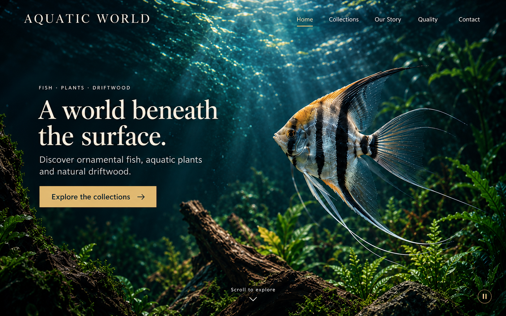
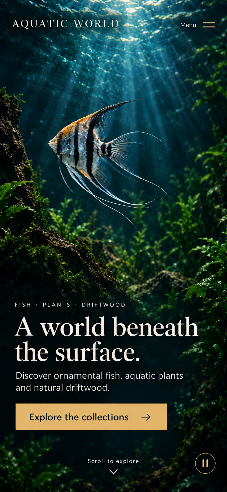

# Immersive Home Static Visuals v1

Created 2026-10-12 with the built-in `image_gen.imagegen` tool. Status: selected concept drafts for user review; not an implemented website, approved video asset or verified responsive UI. No Codex/Claude implementation CLI, video generation or website code change occurred.

## Selected visuals

| File | Native dimensions | Bytes | SHA-256 |
| --- | --- | --- | --- |
| [Desktop](desktop-v1.png) | 1586×992 | 2,371,655 | `3403272a0cfa5a918760a6746b912bf5a0f530dded0864e1ec1b9a71abea96e9` |
| [Mobile](mobile-v1.png) | 853×1844 | 2,060,442 | `9232370d0b3ecf5169e25f4aa3a008e1938b8c3e3d3629d67d8068d609c5c6e5` |

Desktop composition targets approximately a 1440×900 viewport; the portrait concept targets 390×844. The table records actual generated bitmap sizes, not browser viewport tests. Final PNGs were copied byte-for-byte into this directory, without resizing or re-encoding.

## What was visually reviewed

The desktop places the five navigation links directly over water, with an understated Home underline. The main heading and gold collection action occupy the quiet left region; the complete fish silhouette stays at right. The water extends behind header, copy and controls to every edge, without a solid header band, boxed media, central Play button or timeline.

The phone uses a separately composed vertical habitat. Wordmark and Menu sit at the top, fish above the reading area, and the same heading/description/action below. The first mobile draft placed the long tail rays too close to the right edge. One targeted image-tool refinement reduced and moved the fish while preserving the UI layout. The selected result has visible breathing room around all fin extremities and retains the full CTA within the concept screen. Text was visually checked for the exact first-screen strings from [the shared brief](../BRIEF.md).

Both are first-screen concepts, not full-page scroll-state renders. The common brief still requires the underwater environment behind the collection chapter, perspective chapter and footer. These two images cannot establish that behavior. Icon placement is illustrated; actual contrast across moving frames, typography rendering, touch target sizes, keyboard access and navigation require the later implementation review.

## Provenance and limits

The common scene/subject reference is [the original angelfish illustration](../../../comparison/assets-v1/hero-angelfish.png), with SHA-256 `8e69f724fd29a138a438afa05739a77b81bc01e795eb115532fb8416efbeb3d1` and [original provenance](../../../comparison/assets-v1/asset-manifest.json). This is fictional AI imagery, not verified company photography. Image generation recomposed the reference; it is not a pixel-identical overlay of the original.

Desktop generation used the original scene reference. Mobile generation used that scene and the selected desktop as its visual-system reference. The final mobile edit used the first mobile output as its target. [Exact prompts](PROMPTS.md) include all three calls. The tool did not expose a serving model identifier or billed cost; neither is inferred. Original tool outputs remain in the local Codex generated-images directory; only the selected two are included here.

These images contain rasterized text and UI, so they are **composition references only**. Do not use them as runtime video posters or video-generation first frames. Clean landscape/portrait scene assets, seamless video loops and matching UI-free posters remain pending. The future builders receive these same selected references after any user-approved revision; they still implement real text, links and controls. Existing source assets, historical trials and published demos remain unchanged.
